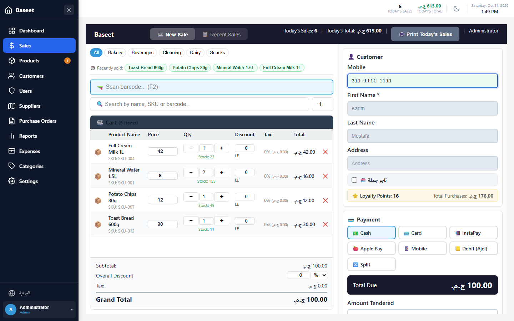
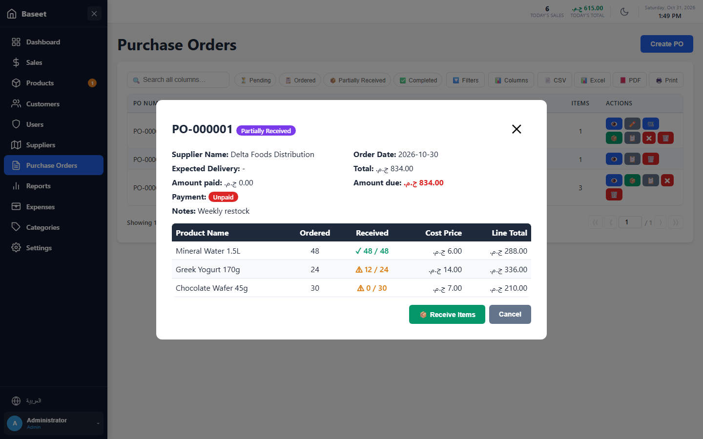
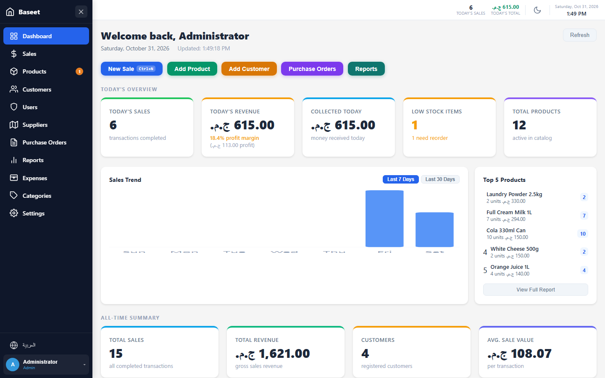
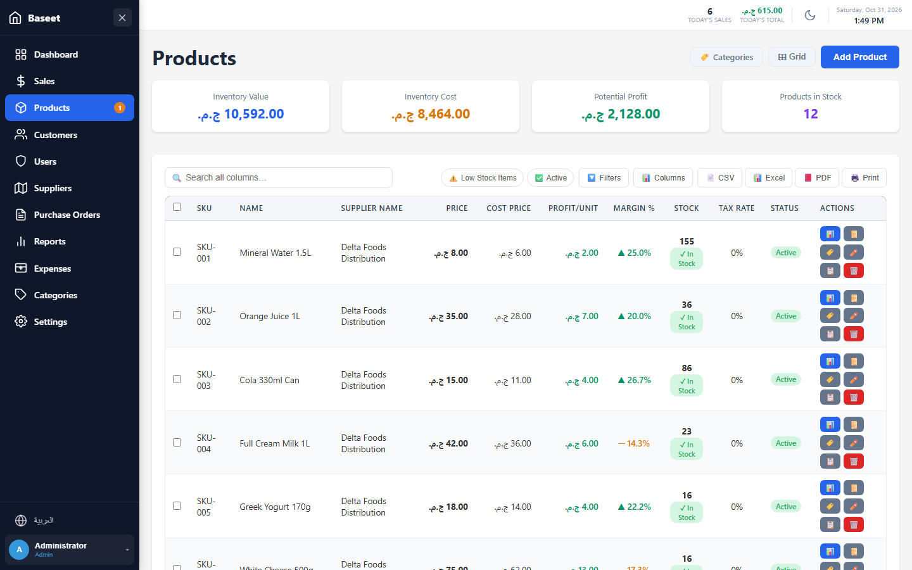
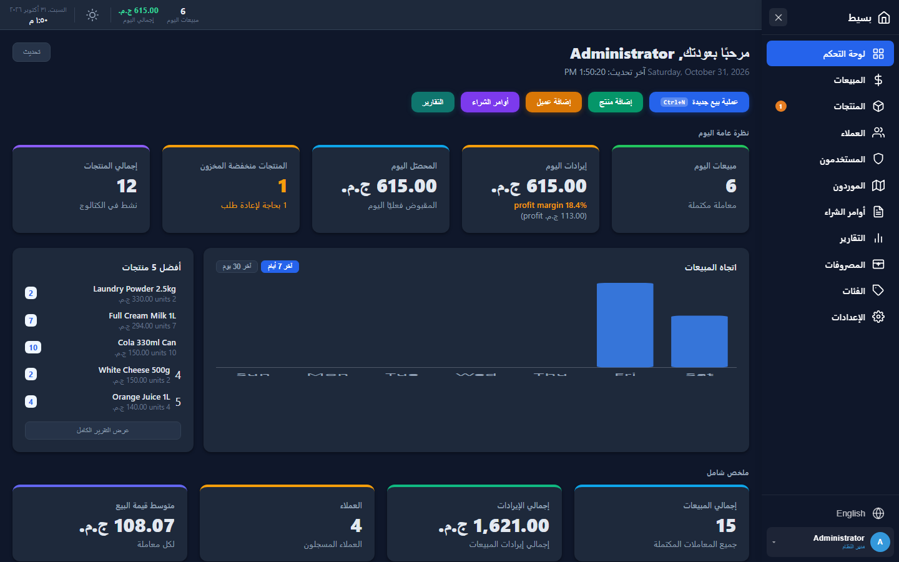
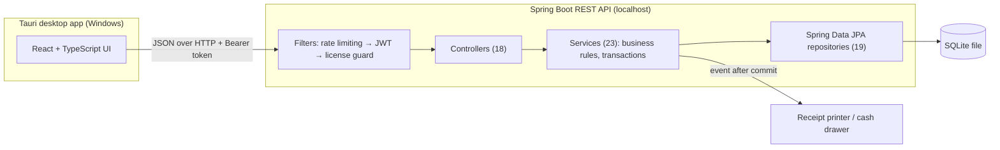
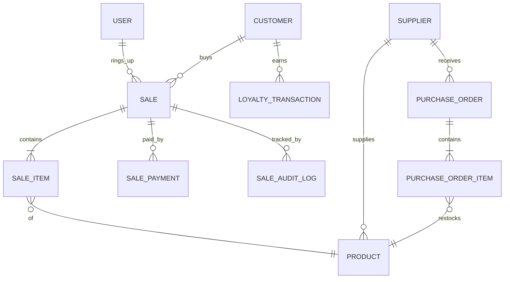

# Baseet: offline point-of-sale and stock system

Baseet ("simple" in Arabic) is a desktop point-of-sale and inventory system for small shops. It runs fully offline, and it's in daily use at **four paying businesses** in Egypt: a supermarket, a stationery shop, a poultry clinic and a building-supplies store.

It's a commercial product (now under [AlcedoTech](https://alcedotech.io)), so the source code is private. This repository explains what it does, how it's built, and what I learned building it. I'm happy to walk through the code live in an interview.

<!-- TODO(Mohamed): optional, add a 1-2 minute demo video link here -->

Screenshots use invented demo data.

---

## What it does

- **Sales:** barcode labels, cash / card / mobile wallet / split payments, holds and resumes, refunds (full, partial, per item), voids, printed receipts and a cash drawer
- **Customers:** loyalty points, credit ("debit") tabs with credit limits, wholesale pricing
- **Inventory:** stock in pieces or boxes, low-stock alerts, price history, barcode labels
- **Suppliers and purchasing:** purchase orders, partial and full goods receiving, supplier balances
- **Back office:** expenses, daily sales summaries, profit reports, Excel/PDF export, backup and restore
- **Interface:** Arabic (right-to-left) and English, light and dark themes, keyboard shortcuts for the till
- **Control:** roles (Admin, Manager, Cashier), manager approval for large discounts, audit logs on every sale change

## Screenshots

| Receiving a supplier delivery (partial) | Dashboard |
|---|---|
|  |  |
| **Products and margins** | **Arabic, dark theme** |
|  |  |

## Stack

| Layer | Technology |
|---|---|
| Backend | Java 17, Spring Boot 4, Spring Security, JWT (jjwt), Spring Data JPA / Hibernate, Bean Validation, Maven |
| Database | SQLite (single file, offline), optimistic locking with `@Version` |
| Frontend | React 18, TypeScript, Vite, React Router, TanStack Table, Zod, Axios |
| Desktop | Tauri (packaged Windows installer) |
| Tests | JUnit 5 + Spring Boot Test + Spring Security Test (483 backend tests, all passing), Vitest + Testing Library on the frontend |

## Architecture

Classic layered design: controllers handle HTTP and validation, services own the rules and the `@Transactional` boundary, repositories talk to the database. Everything runs on the shop's own PC, so a lost internet connection never stops a sale.

## Data model (core)

19 JPA entities in total, including price history, expenses, daily summaries and debit-adjustment logs.

## Three flows, explained

### 1. Making a sale

1. The request carries an **idempotency key**, so a double click can't create the same sale twice.
2. Prices are **re-read from the database**, never trusted from the client, and every line is checked against stock.
3. Totals are calculated on the server: line discounts, then the sale discount, then tax on what the customer actually pays.
4. A discount above the cashier's limit needs **manager approval**.
5. Everything (sale, stock decrease, customer tab, loyalty points, audit row) happens in **one transaction**. If any step fails, nothing is written.
6. The cash drawer opens through an **event published after commit**, so hardware never holds up the database.

### 2. Receiving goods from a supplier

Purchase orders move through `PENDING → ORDERED → RECEIVED (partial) → COMPLETED`, or `CANCELLED`.

- Each received line is validated: no negative quantities, never more than was ordered.
- Box lines are converted to pieces before stock is updated.
- Stock changes go through the **same service method as sales and refunds**, so every stock movement leaves an audit row.
- The product's cost price is updated from what was actually paid (per piece for boxes), so profit reports stay correct.

### 3. Login and access control

- Passwords are hashed with **BCrypt**. Login returns a **JWT**.
- A `OncePerRequestFilter` validates the token on every request. **Logout blacklists the token**, and repeated failed logins are rate-limited.
- Stateless sessions, method-level security (`@PreAuthorize`) by role, and CORS locked to the desktop app's origins.

## Concurrency, honestly

SQLite has no `SELECT … FOR UPDATE`, so a pessimistic lock doesn't actually block anything there. Oversell protection comes from **optimistic locking** (`@Version` on products, sales, customers and more) plus SQLite's single-writer lock. That's fine for one till per shop. A multi-terminal version would need PostgreSQL and real row locks.

## How I built it, and my role

Baseet is my own product, built solo from February to September 2026 with **AI-assisted development (Claude Code)**: architecture, backend, frontend, the Windows installer and the licensing. I directed the work, tested it against real shop scenarios, and fixed what failed in the field. It now sits under AlcedoTech, the studio I co-founded, so my co-founders can help develop it further.

I also sold it, installed it on site, trained the cashiers, and I handle support.

<!-- TODO(Mohamed): if any rule above (idempotent sales, manager approval, per-box costing...) came from a real problem in a shop, add one sentence about it here. -->

**What I learned:** AI got us to a working product fast, but I let the code grow faster than my own understanding of it. I'm now reviewing the codebase layer by layer until I can explain every part without notes. AI writes code quickly. It doesn't take responsibility for it. I do.

---

**Mohamed Hussein** · Java / Spring Boot developer · [LinkedIn](https://linkedin.com/in/moham9dhussein)
